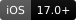
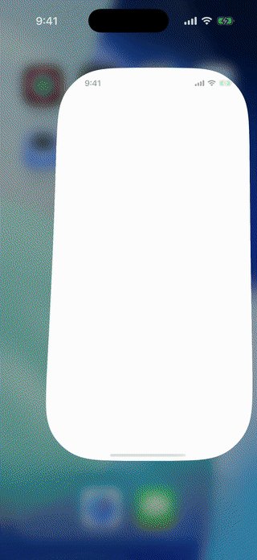
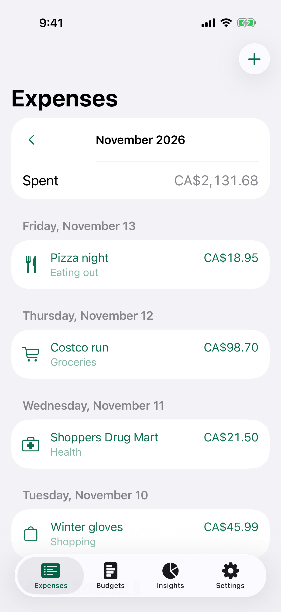
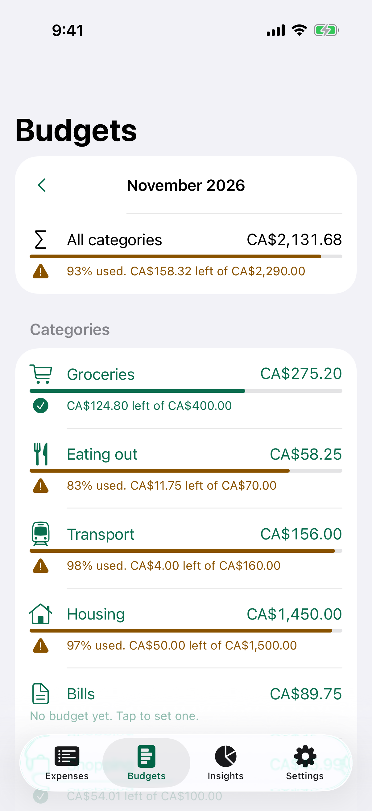
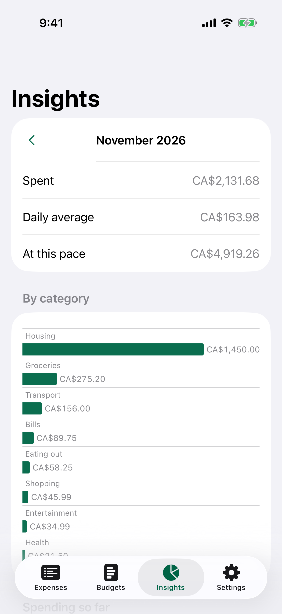
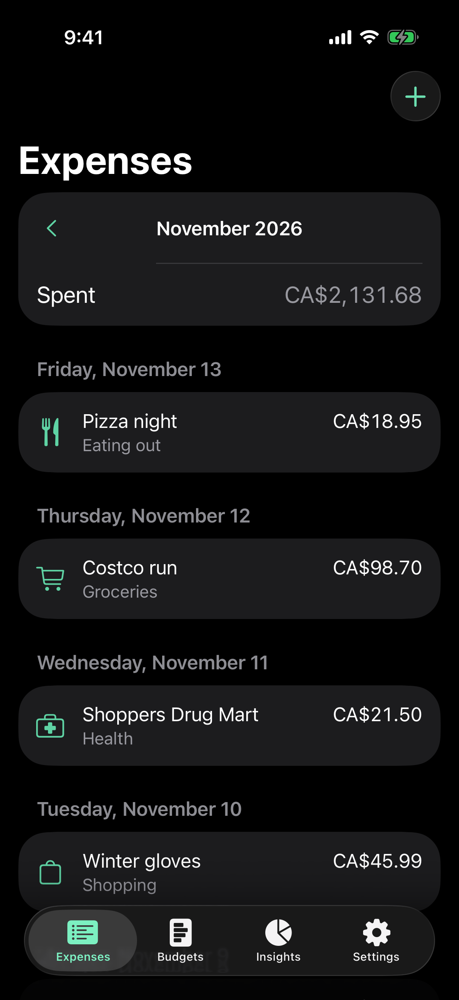

<div align="center">

# 💸 Pocket Budget

**A SwiftUI budget tracker: log what you spend, set a monthly budget for each category and see where your money goes. Saved on the phone with SwiftData, with a Home Screen widget and Siri Shortcuts**

[](https://github.com/jamierowe15/pocket-budget/actions/workflows/ci.yml)
[](project.yml)
[](#-tech)
[](#-features)
[](#-coverage)
[](LICENSE)

<!-- auto:demo -->

<!-- /auto:demo -->

</div>

<!-- auto:gallery -->
| Expenses | Budgets | Insights | Dark Mode |
|---|---|---|---|
|  |  |  |  |
<!-- /auto:gallery -->

## 📑 Contents
- [Features](#-features)
- [Tech](#-tech)
- [Run it](#-run-it-on-a-mac)
- [Coverage](#-coverage)
- [Docs](#-docs)
- [Related iOS labs](#-related-ios-labs)

## ✨ Features

- Add, edit and delete expenses, grouped by day, month by month
- Monthly budgets per category with a warning at 80% and a clear "over budget" state
- Insights: spending by category and a running total against the budget (Swift Charts)
- Home Screen and Lock Screen widget
- "Log an expense in Pocket Budget" with Siri or the Shortcuts app
- Daily reminder notification, CSV export, works fully offline
- VoiceOver, Dynamic Type up to the largest size, Dark Mode, iPad

## 🛠 Tech

| Area | Used |
|---|---|
| UI | SwiftUI, `@Observable`, `NavigationStack`, `TabView`, Swift Charts |
| Data | SwiftData (`@Model`, `@Query`, `#Predicate`); rules in the `BudgetKit` package (Swift 6 mode) |
| System | WidgetKit + App Groups, App Intents (Siri, Shortcuts), UserNotifications, ShareLink |
| Tests | Swift Testing (package + app), XCTest UI tests, accessibility audit, 70% coverage gate |
| CI | GitHub Actions on macOS and Linux; protected `main` |

## 🚀 Run it (on a Mac)

```bash
brew install xcodegen
xcodegen generate
open PocketBudget.xcodeproj    # pick a simulator, press Cmd+R
```
Add `-sampleData` under Product > Scheme > Edit Scheme > Arguments to start with demo data.
No Mac? Every push is built and tested on GitHub's Macs: see the Actions tab.

## ✅ Coverage

<!-- auto:coverage -->
| Package | Line coverage | Lines | Gate |
|---|---|---|---|
| BudgetKit | 95.4% | 260 | PASS (min 70%) |
<!-- /auto:coverage -->

## 📚 Docs

[Day 1](docs/day-1.md) · [Day 2](docs/day-2.md) · [Day 3](docs/day-3.md) · [Accessibility](docs/accessibility.md) · [Job requirements](docs/REQUIREMENTS.md)

## 📱 Related iOS labs

| App | Focus |
|---|---|
| [Maple Wallet](https://github.com/jamierowe15/maple-wallet) | Modular SwiftUI banking demo: Swift 6 concurrency, OAuth PKCE, offline cache, VoiceOver |
| [Loonie Rates](https://github.com/jamierowe15/loonie-rates) | UIKit app with Bank of Canada exchange rates, Swift Charts, English and French |
| [Pocket Budget](https://github.com/jamierowe15/pocket-budget) | SwiftUI + SwiftData budget tracker with a widget and Siri Shortcuts |

---

<div align="center">

**Jamie Rowe** · [github.com/jamierowe15](https://github.com/jamierowe15) · Toronto, ON

*All data stays on the device. Demo data only.*

</div>
