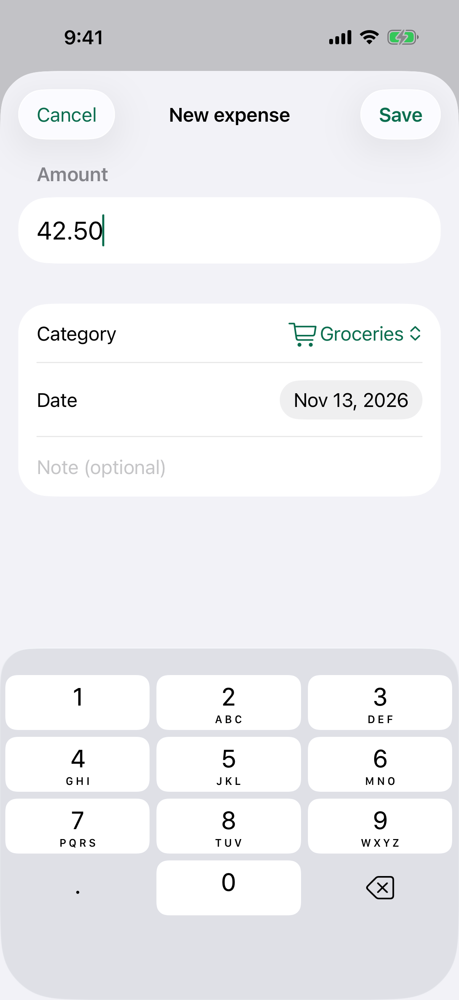
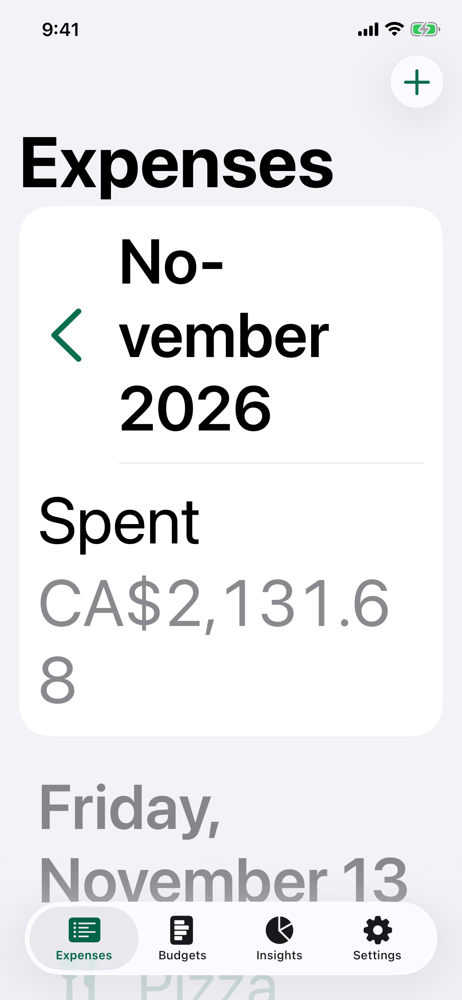
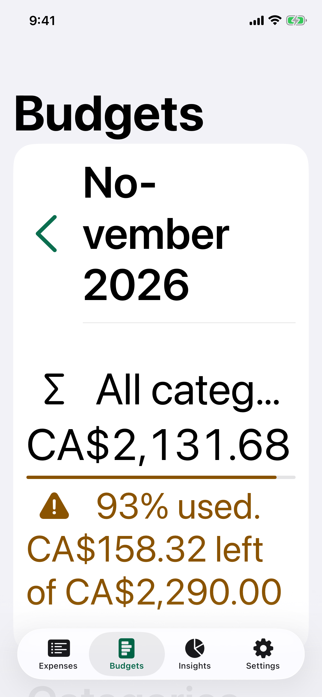

# Day 3: Widget, Siri, reminders, UI tests and evidence

## Goal
Reach the person outside the app (Home Screen, Siri, notifications), then prove the whole
thing works with UI tests and an accessibility audit, and lock `main`.

## System features
| Feature | How it works |
|---|---|
| Widget | `Widget/PocketBudgetWidget.swift`. The app writes a `WidgetSnapshot` to a shared App Group after every change and calls `WidgetCenter.reloadAllTimelines()`. The widget reads it; it never opens the database. |
| Siri and Shortcuts | `App/Intents/LogExpenseIntent.swift`. An `AppIntent` with amount, category (`AppEnum`) and note, plus `AppShortcutsProvider` phrases that work with no setup. |
| Reminders | `ReminderScheduler`: a repeating local notification at 8 PM, permission asked only when the switch is turned on. |
| Privacy | `PrivacyInfo.xcprivacy` declares UserDefaults use; nothing leaves the device. |

## UI tests
| Test | Proves |
|---|---|
| `testAddAnExpense` | The main flow: +, amount, category, note, save, row appears |
| `testSaveIsDisabledForNonsense` | Validation blocks a zero amount |
| `testEditThenDeleteAnExpense` | Edit through the form, delete by swiping |
| `testSetABudget` | Setting a budget updates the row VoiceOver reads |
| `testInsightsDrawCharts` | Charts and the projection appear |
| `testPreviousMonthShowsOctober` | Month switching re-runs the query |
| `AccessibilityAuditTests` | Xcode's accessibility audit on every screen |

## Screens
<!-- auto:screens-day3 -->
| Adding an expense | Largest text: expenses | Largest text: budgets |
|---|---|---|
|  |  |  |
<!-- /auto:screens-day3 -->

## CI proof
<!-- auto:ci-proof -->
[This throwaway pull request](https://github.com/jamierowe15/pocket-budget/pull/4) added a deliberately failing test. CI went red and GitHub blocked the merge, so the PR was closed unmerged.
<!-- /auto:ci-proof -->

## Coverage
<!-- auto:coverage -->
| Package | Line coverage | Lines | Gate |
|---|---|---|---|
| BudgetKit | 95.4% | 260 | PASS (min 70%) |
<!-- /auto:coverage -->

<!-- auto:run -->

<!-- /auto:run -->
